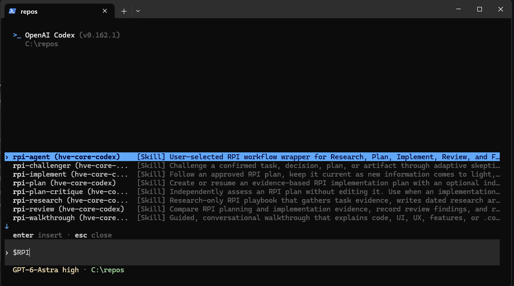
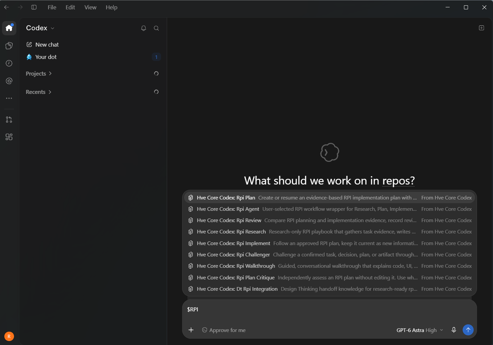

# HVE Core for Codex

An **unofficial port of [Microsoft HVE Core](https://github.com/microsoft/hve-core) to Codex**. It is not made or endorsed by Microsoft.

We take HVE Core’s original files and run them through a **deterministic converter**—the same inputs produce the same output. It translates skills, agents, prompts, instructions, and supporting files into formats Codex understands, and adds hooks that help load the right guidance. The original source is retained, and compatibility changes are recorded for review.

Bring HVE Core's guided workflows to both Codex CLI and desktop.

| Codex CLI | Codex desktop |
| --- | --- |
|  |  |

**How it works**: The GH Actions workflow periodically fetches HVE Core and migrates the distribution into a packaged release. Stable follows Microsoft’s published releases. Edge follows the newest work on `main`. The GitHub workflow checks both weekly and publishes changed sources automatically after migration checks pass. Only failures need attention; no paid model tests run during publication.

The current HVE Core upstream golden eval set pass rate is about ~59%. Microsoft's eval set uses certain regular expressions and mannerism detections that are fine-tuned for Claude Haiku. There may also be semantic errors, but the core workflows are functional.

## Quickstart

### Install once for all your projects

Install [uv](https://docs.astral.sh/uv/getting-started/installation/), then run one command in PowerShell or your terminal:

```sh
uv run https://raw.githubusercontent.com/neil-119/hve-core-codex/main/scripts/install_release.py --release edge
```

This installs the latest published **edge** release globally, including the plugin, agents, and hooks. It downloads the release ZIP and installer, checks their SHA-256, and preserves existing Codex settings.

For the older stable release:

```sh
uv run https://raw.githubusercontent.com/neil-119/hve-core-codex/main/scripts/install_release.py
```

Or pin an exact tag from [our releases](https://github.com/neil-119/hve-core-codex/releases):

```sh
uv run https://raw.githubusercontent.com/neil-119/hve-core-codex/main/scripts/install_release.py --release YOUR_RELEASE_TAG
```

Add `--target "/path/to/project"` for a project-only install, `--no-plugin` for direct skills, or `--update` to update an existing installation. Windows and WSL need separate installs. Do not keep duplicate HVE skills at both global and project scope.

Restart Codex, install/enable **HVE Core for Codex** from Plugins if prompted, and review the hooks through Codex's normal trust controls (`/hooks` in the CLI). [Building and advanced setup](docs/development.md) are for developers.

### Update

Close your Codex sessions, then update to the newest published edge release:

```sh
uv run https://raw.githubusercontent.com/neil-119/hve-core-codex/main/scripts/install_release.py --release edge --update
```

Use `--release stable` or an exact release tag to choose another version. For a project-only installation, include the same `--target` used when installing. Updates replace the managed registrations, so running an update repeatedly does not add extra hooks or plugin registrations. Unrelated settings are preserved; conflicting local edits are reported. Restart Codex afterward and review any new hook trust prompts. The four hooks have distinct labels for session start, subagent start, prompt submission, and tool use.

### Uninstall

Close your Codex sessions, then remove the global HVE integration:

```sh
uv run https://raw.githubusercontent.com/neil-119/hve-core-codex/main/scripts/install_release.py --uninstall
```

Add `--target "/path/to/project"` to remove a project-only installation instead. Add `--dry-run` to preview removal. This uses your existing installer without downloading a release. It removes owned files, hook entries, and plugin registrations, while preserving unrelated settings, locally edited files, and recovery backups. Review any reported conflicts. Restart Codex afterward.

Once all global and project installations are removed, optionally remove the installer itself:

```sh
uv tool uninstall hve-core-codex
```

### Codex CLI

Install and sign in using the [official CLI setup guide](https://learn.chatgpt.com/docs/codex/cli). Then:

```sh
cd /path/to/your-project
codex
```

### Codex desktop

Install the [desktop app](https://learn.chatgpt.com/docs/app), sign in, and open your project in Codex. Restart the app if the new skills do not appear.

### Codex in VS Code

Install the official [Codex extension](https://learn.chatgpt.com/docs/codex/ide), sign in, and open your project folder. Choose the Codex sidebar and start a local chat. Reload VS Code if the new skills do not appear.

## Try a small task from start to finish

Start with full **RPI (Research → Plan → Implement)**. Use the entrypoint for your installed channel:

- **Stable:** `$rpi task="Add a greeting function that returns Hello, <name>."` starts the ported RPI workflow.
- **Edge:** Invoke the `$rpi-agent` skill and describe the task to start the ported RPI workflow.

Then send:

```text
Run research, planning, implementation, and review. Add a test and run it.
I authorize changes inside this project. Leave the changes uncommitted.
```

The workflow coordinates the stages and keeps progress notes in `.copilot-tracking/`. Review the resulting changes and test results. To pause before coding, say “Research and plan only; wait for my approval before implementation.”

### Run individual stages instead

You can invoke each task separately too. `$name` calls a skill; type `$` to find one, or use `$hve-catalog` to browse. Stable and Edge use different phase-skill names:

| Stage | Stable skill | Edge skill |
| --- | --- | --- |
| Research | `$task-research` | `$rpi-research` |
| Plan | `$task-plan` | `$rpi-plan` |
| Implement | `$task-implement` | `$rpi-implement` |
| Review | `$task-review` | `$rpi-review` |

Send these prompts one at a time in the same chat, replacing the skill line with the matching name above:

1. **Research:** learn where the change belongs.

   ```text
   $task-research topic="Add a greeting function that returns Hello, <name>."
   Research only. Do not change the code yet.
   ```

2. **Plan:** turn the research into small steps.

   ```text
   $task-plan
   Use the research above. Include a test. Stop for my review before implementation.
   ```

3. **Implement:** read the plan, then give approval when ready.

   ```text
   $task-implement
   I approve the plan above. Implement it and run the relevant tests.
   Leave the changes uncommitted.
   ```

4. **Review:** check the result against the plan.

   ```text
   $task-review
   Review the implementation and test results against the plan.
   Report problems and anything that could not be verified.
   ```

Stable pairs these stages with the `task-researcher`, `task-planner`, `task-implementor`, and `task-reviewer` agents. Edge's full workflow uses the `rpi-agent` role. You can also ask directly: “Use the functional-code-review agent to review my changes without editing them.”

For more workflow ideas, see [Microsoft’s HVE Core guidance](https://github.com/microsoft/hve-core). See [how the port works](ELI5.md) or [our setup guide](docs/development.md) for more detail.

## LICENSE
See [LICENSE](./LICENSE) and [THIRD-PARTY-NOTICES](./THIRD-PARTY-NOTICES.md).